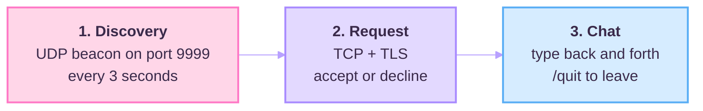

<div align="center">


<a href="https://git.io/typing-svg">
  
</a>

<br/>


<br/>

**A peer-to-peer chat app that lives in your terminal and works over your local network.**
Start it on two machines on the same network, find each other, and talk.

<sub>(\*^‿^\*)&nbsp;&nbsp;Built with Python and <code>asyncio</code>&nbsp;&nbsp;(\*^‿^\*)</sub>

</div>

<br/>


## &#9733; Table of Contents

| | |
|---|---|
| [How it works](#-how-it-works) | The three-step flow from beacon to chat |
| [Rules](#-rules) | Busy states, cooldowns, timeouts |
| [Project layout](#-project-layout) | What each file does |
| [Requirements](#-requirements) | What you need installed |
| [Setup](#-setup) | Certificate generation and first run |
| [Usage](#-usage) | Step by step, plus single-machine testing |
| [Security](#-security) | Honest limitations |
| [Troubleshooting](#-troubleshooting) | When things go sideways, including Wireshark tips |
| [Known limitations](#-known-limitations) | Rough edges |
| [Ideas for later](#-ideas-for-later) | The roadmap |

<br/>

## &#10047; How it works



### &#9312; Discovery &nbsp;<sub>UDP</sub>

Every instance broadcasts a small JSON beacon to UDP port `9999` every 3 seconds. The beacon contains:

- a random **ID**
- a **nickname**
- the **TCP port** it is listening on

Every instance also listens for other people's beacons and keeps a list of the peers it has seen.

### &#9313; Request &nbsp;<sub>TCP + TLS</sub>

When you pick a peer, your app connects to that peer's TCP port and sends a chat request. The other person sees a prompt and presses `1` to accept or `2` to decline.

### &#9314; Chat

On accept, both terminals clear and you can type back and forth. Type `/quit` to leave.

```text
mare: hello
djole: hi
mare: how are you doing
djole: good and you?
```

<br/>

## &#10048; Rules

> [!NOTE]
> **Busy means busy.** If you are already in a chat or answering a request, incoming connections are dropped and the sender is told you are busy.

> [!NOTE]
> **Declined requests** show the sender "X declined your request".

| Rule | Value |
|---|---|
| Cooldown between sending requests | **5 seconds** |
| Request timeout, receiving side | **25 seconds** |
| Request timeout, sending side | **30 seconds** |

<br/>

## &#10022; Project layout

| File | What it does |
|---|---|
| `main.py` | Asks for a nickname, starts the TCP server and the beacon, runs the menu |
| `discovery.py` | UDP beacon and listener, and the "Discover hosts" screen |
| `connection.py` | TLS server, request/accept/decline flow, chat loop, keyboard input routing |

<br/>

## &#10040; Requirements

- **Python 3.11 or newer** (uses `loop.sock_recvfrom` and `match`)
- **Linux or macOS** (uses `clear` and reads stdin in a background thread)
- **OpenSSL**, to generate a certificate
- **No third-party packages**

<br/>

## &#10053; Setup

Generate a certificate and key and put them in the folder you run the app from:

```bash
openssl req -x509 -newkey rsa:2048 -nodes \
  -keyout key.pem -out cert.pem -days 365 -subj "/CN=p2pchat"
```

Then run:

```bash
python main.py
```

Do this on each machine (or in two terminals on one machine, see [Testing on one machine](#testing-on-one-machine)).

<br/>

## &#9825; Usage

1. Enter a **nickname**.
2. Choose **2 - Discover hosts** and wait for other people to show up. Press <kbd>Enter</kbd> to stop searching.
3. Choose **1 - Start chatting**, pick a number from the list and wait for a reply.
4. The other person presses <kbd>1</kbd> to accept or <kbd>2</kbd> to decline.
5. Chat. Type `/quit` to leave.

### Testing on one machine

Open two terminals, run `python main.py` in each, and use different nicknames. Discovery uses `SO_REUSEADDR` and the TCP port is picked by the OS, so two instances can run side by side.

<br/>

## &#10070; Security

The chat connection (TCP) is encrypted with **TLS**. A few honest limitations:

> [!WARNING]
> **Encryption, not identity.** The client does not verify the server's certificate, so this protects against someone sniffing the Wi-Fi but **not** against someone impersonating a peer.

> [!WARNING]
> **Beacons are plaintext.** Nicknames, IDs and ports sent over UDP are visible to everyone on the network and can be spoofed.

<br/>

## &#10049; Troubleshooting

<details>
<summary><b>Peers don't show up</b></summary>
<br/>

Check that both machines are on the same network and that your firewall allows UDP `9999`. Guest networks and some public Wi-Fi block device-to-device traffic (AP isolation).

</details>

<details>
<summary><b>Connection fails right after sending a request</b></summary>
<br/>

Check that both sides have `cert.pem` and `key.pem`, and that your firewall isn't blocking the TCP port (it is random each run).

</details>

<details>
<summary><b><code>FileNotFoundError</code> for <code>cert.pem</code></b></summary>
<br/>

The path is relative to where you run the command. Run `python main.py` from the folder that contains the certificate.

</details>

### Looking at the traffic with Wireshark

| What | Filter | What you should see |
|---|---|---|
| Beacons | `udp.port == 9999` | The JSON payload, in plain sight |
| Chat | `tcp.port == <port>` | TLS `Application Data` packets with unreadable contents |

The port for the chat filter is in the beacon payload.

> [!TIP]
> Two instances on the same machine talk over the loopback interface, so capture on `lo` or `any`, not your Wi-Fi interface.

<br/>

## &#10086; Known limitations

- Peers are never removed from the list once seen, so people who left stay listed.
- The peer list only updates while the Discover screen is open.
- Messages that arrive while you are mid-sentence print over your input.
- No message history, no group chats, no file transfer.

<br/>

## &#10032; Ideas for later

- [ ] Expire peers that stop beaconing
- [ ] Keep discovery running in the background
- [ ] Per-instance certificates with fingerprint checking
- [ ] A nicer terminal UI (for example with `prompt_toolkit`)
- [ ] **Anonymization:** a global relay server with all traffic routed over Tor, so peers can chat across networks without exposing their IP addresses

<br/>

<div align="center">

<sub>(\*˘︶˘\*)&nbsp;&nbsp;thanks for stopping by&nbsp;&nbsp;(\*˘︶˘\*)</sub>


</div>
